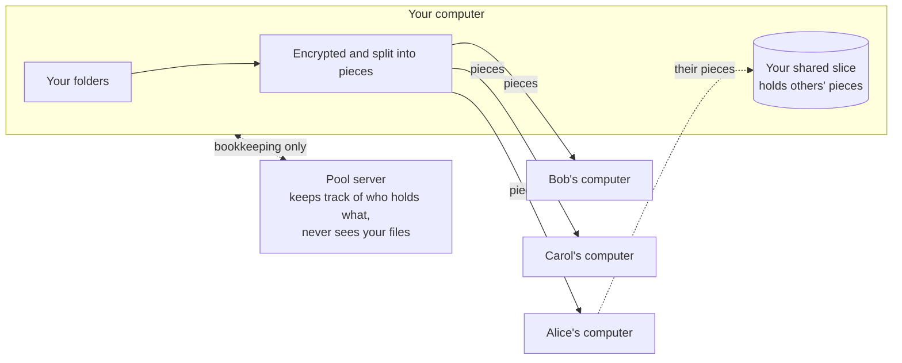
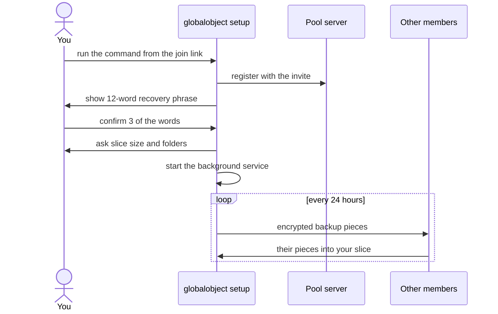
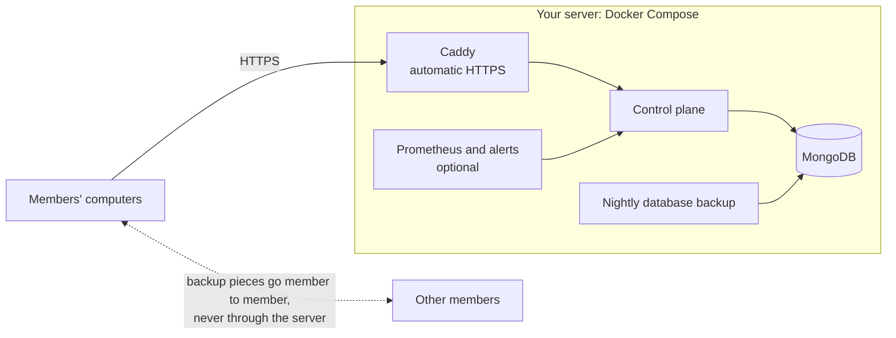
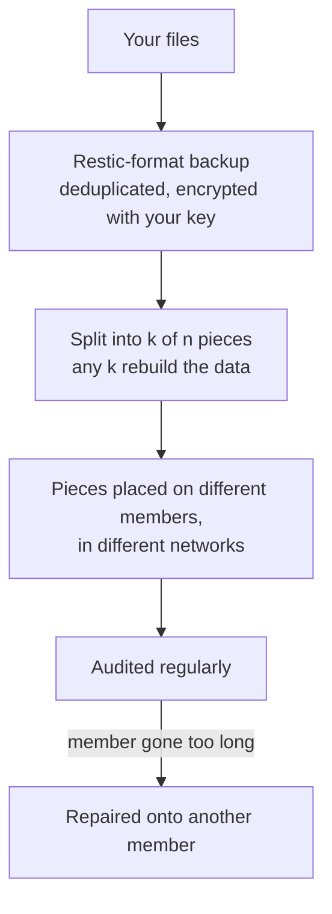

# GlobalObject

**Back up your files onto your friends' computers, and let them back up onto yours.**

You share a slice of your spare disk with a pool of people. In return, your folders are backed up onto their
machines. Everything is encrypted on your computer before it leaves, so nobody else in the pool, including whoever
runs it, can read your files. Lose your laptop and you get everything back with 12 words.

> **Status: prototype. Not safe for real data yet.** Tested on loopback only. See [docs/status.md](docs/status.md).



Each backup is stored several times over on different people's machines, so it survives some of them being offline
or gone for good. When a machine disappears, the pool copies the missing pieces somewhere else automatically.

## Getting started

There are two ways in:

| You want to… | Do this |
|---|---|
| **Back up your files** in a pool someone else runs | [Join a pool](#join-a-pool). You need a join link and about two minutes. |
| **Run a pool** for your family, friends or club | [Run a pool](#run-a-pool). You need a server with Docker and a domain name. |

You need **Linux or macOS**. Windows isn't supported yet.

## Join a pool

### 1. Get a join link

Ask whoever runs the pool for one. It looks like `https://cp.example.org/join/1a2b3c…` and works once.

### 2. Open it and run the command it shows

The page shows one command. It looks like this:

```sh
curl -fsSL https://cp.example.org/install.sh | sh -s -- --join https://cp.example.org/join/1a2b3c…
```

### 3. Answer four questions

| Question | Default | Tip |
|---|---|---|
| Your recovery phrase | 12 new words | **Write them down on paper.** They are the only way to get your files back on a new machine. Nobody can reset them for you. |
| How much disk to share | A quarter of your free space | You get roughly a quarter of what you share as backup space. |
| Which folders to back up | Documents, Pictures, Desktop | Add more later with `globalobject paths add ~/Music`. |
| How often | Every 24 hours | |

That's it. A background service now backs up on schedule, shares your slice with the pool, and keeps running
after restarts.



### Day to day

```sh
globalobject status       # is everything healthy? Start here if anything looks wrong
globalobject dashboard    # the same in your browser, plus restores and settings
globalobject backup       # back up now instead of waiting for the schedule
```

The dashboard runs on your own machine at `http://127.0.0.1:7410`:

- check that backups are running
- browse snapshots and restore files
- change your shared space and folders

### New computer, or lost the old one

Install, then restore with your recovery phrase:

```sh
curl -fsSL https://github.com/metahertz/globalobject/releases/latest/download/install.sh | sh -s -- --no-setup
globalobject setup --restore --server https://cp.example.org    # then type your 12 words
```

More in the [user guide](docs/user-guide.md).

## Run a pool

The pool server, called the control plane, keeps track of members, machines and which pieces are where. It never
holds anyone's files or keys, and no backup data passes through it.

On a Linux server with Docker, and a DNS name pointing at it:

```sh
curl -fsSL https://raw.githubusercontent.com/metahertz/globalobject/main/deploy/install-server.sh \
  | GLOBALOBJECT_REPO=metahertz/globalobject sh -s -- --domain cp.example.org --monitoring
```

Or, from a checkout: `./deploy/install-server.sh --domain cp.example.org --monitoring`.

It starts everything, creates a first pool called "Main" and prints the first join link. Send that link to the first
member, who becomes the pool's admin.



### Managing it

Open `https://cp.example.org/admin` and sign in with the operator token from `deploy/compose/.env`. Or use the CLI:

```sh
cd deploy/compose
alias goadmin='docker compose exec control-plane globalobject-control-plane admin'
goadmin status            # health at a glance
goadmin invite 1          # a new join link for pool 1
goadmin create-pool "Family"
goadmin nodes --pool 1
```

**Copy the database backups off the server.** If the database is lost, every pool loses track of where its pieces
are. Upgrading is running the install command again. See the [operations guide](docs/operations.md) for monitoring,
alerts and restores.

## How it works



- **Fair shares.** Your backup space is capped by what you share, and your download speed by what your link
  contributes.
- **Built on existing open source.** restic's repository format through `rustic_core`, `iroh` and `iroh-blobs` for
  connections between members, and PASETO tokens through `pasetors`. See [docs/dependencies.md](docs/dependencies.md).
- **Details:** [architecture](docs/architecture.md), [threat model](docs/threat-model.md),
  [protocol](docs/protocol.md).

## Documents

| | |
|---|---|
| [docs/user-guide.md](docs/user-guide.md) | Joining, the dashboard, restoring, changing what you share |
| [docs/operations.md](docs/operations.md) | Running a control plane: deploy, upgrade, back up, monitor, alerts |
| [docs/status.md](docs/status.md) | What's built, what was verified, and what isn't done |
| [docs/architecture.md](docs/architecture.md) | How it works, and why |
| [docs/threat-model.md](docs/threat-model.md) | Who could attack it, and what remains exposed |
| [docs/dependencies.md](docs/dependencies.md) | Which project does what, licences, and what remains custom |
| [docs/protocol.md](docs/protocol.md) | Grants and APIs |
| [docs/sim-report.md](docs/sim-report.md) | Durability, availability and quota simulations |

## Layout

| Crate | Purpose |
|---|---|
| `crates/crypto` | Signing identities and PASETO tokens |
| `crates/segment` | `(k,n)` coding of encrypted data |
| `crates/policy` | Redundancy, placement, quota and bandwidth rules, shared with the simulator |
| `crates/proto` | Wire types |
| `crates/net` | Peer connections and verified transfers |
| `crates/client` | The `globalobject` CLI: a restic-format repository stored on the grid |
| `crates/node` | The `globalobject-node` storage node |
| `crates/control-plane` | The `globalobject-control-plane` service |
| `crates/sim` | The simulator |
| `crates/e2e` | End-to-end tests |

## Build and test from source

You need Rust and MongoDB running as a replica set, because the control plane uses transactions. One node is enough:

```sh
mongod --replSet rs0 --dbpath ./mongo-data --fork --logpath ./mongod.log
mongosh --eval 'rs.initiate({_id: "rs0", members: [{_id: 0, host: "127.0.0.1:27017"}]})'
export MONGODB_URI='mongodb://127.0.0.1:27017/?replicaSet=rs0&directConnection=true'   # the scripts' default

scripts/test.sh                      # each end-to-end test in its own process
python3 scripts/check-licences.py    # AGPL and GPL stay out

cargo run --release -p globalobject-sim > report.md    # full simulation

cargo build --release -p globalobject-control-plane -p globalobject-node -p globalobject-client
scripts/grid.sh    # real processes: an operator, five owners joining with setup, backup, kill -9, repair, restore
LARGE_MB=2000 scripts/grid.sh    # the same, with a 2 GB file
```

Releases come from pushing a `v*` tag: `.github/workflows/release.yml` builds Linux and macOS binaries, publishes them
with checksums, and pushes the control-plane image to GitHub's container registry.

## Licence

MIT or Apache-2.0. Dependencies are limited to permissive licences, plus MPL-2.0 for unmodified files. See
[docs/dependencies.md](docs/dependencies.md).
